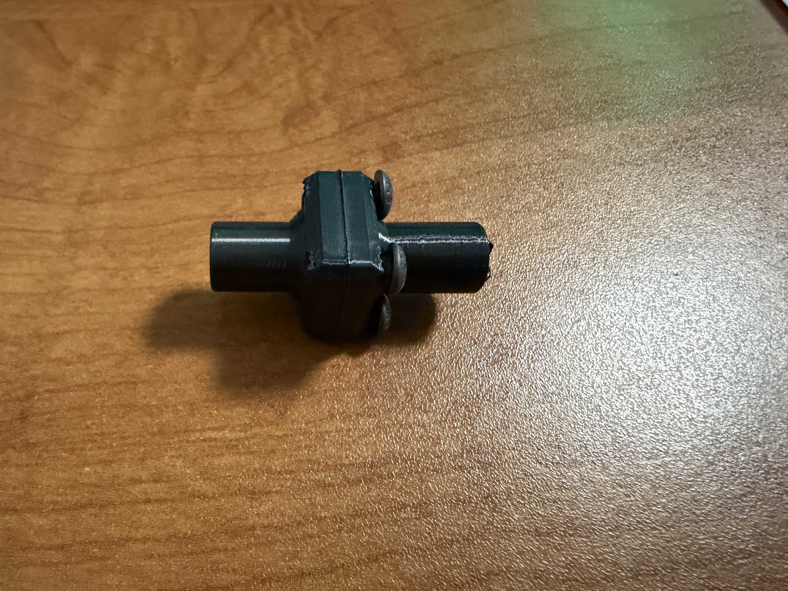
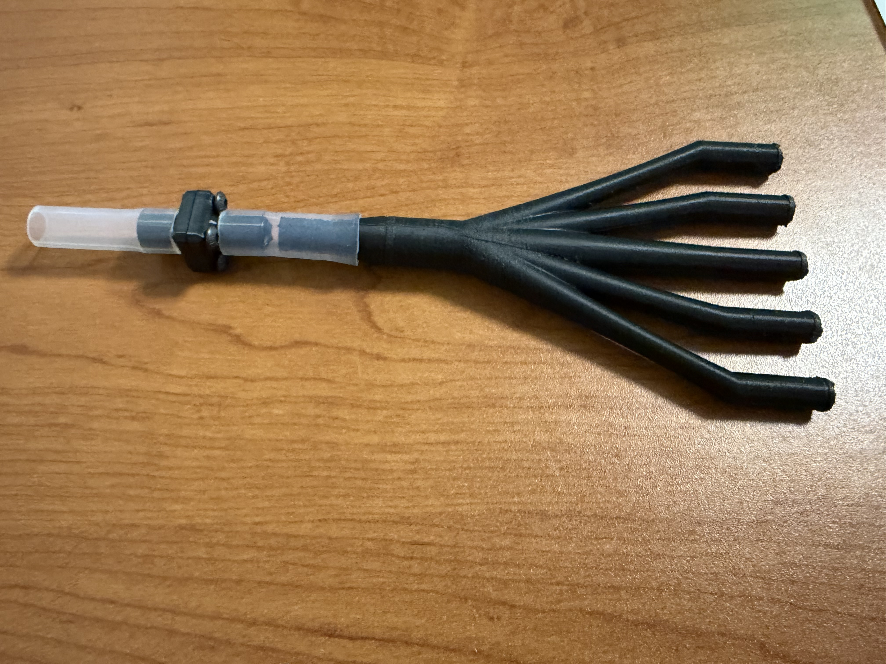
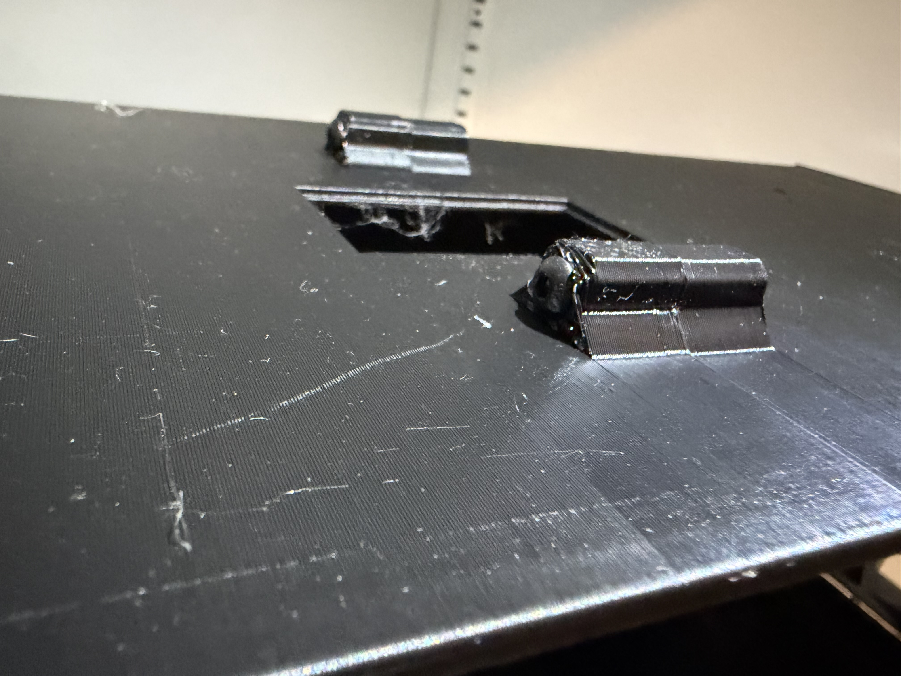
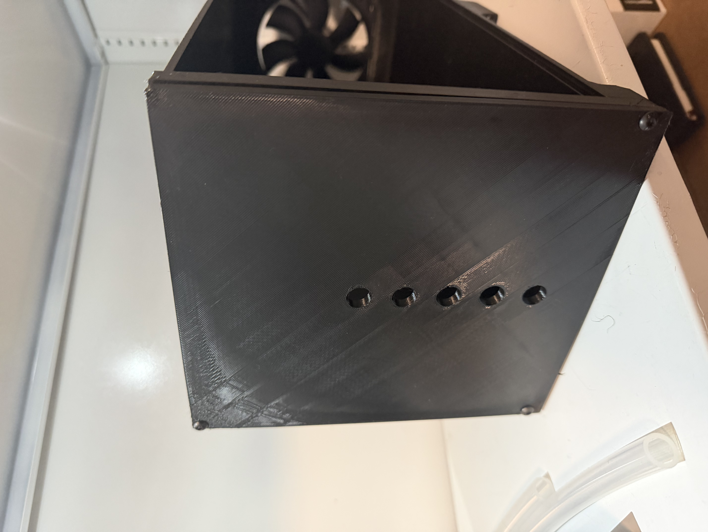
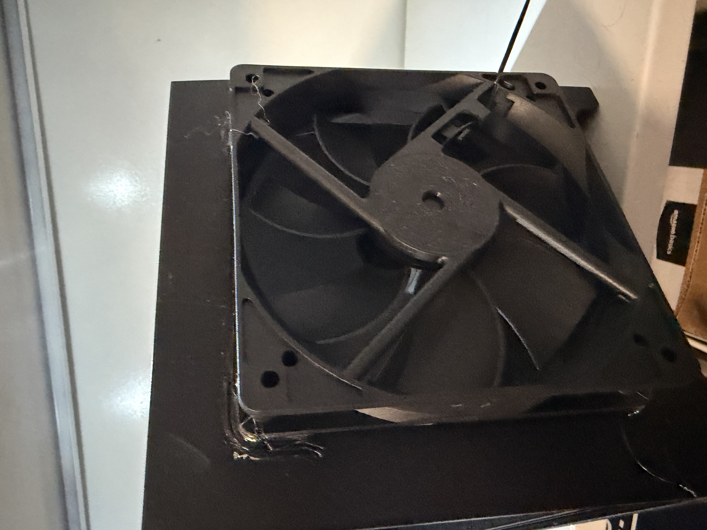
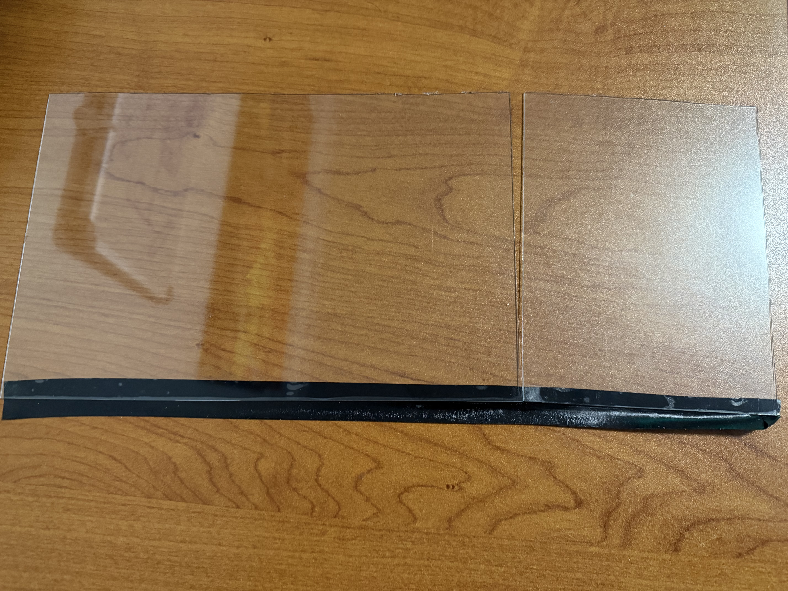
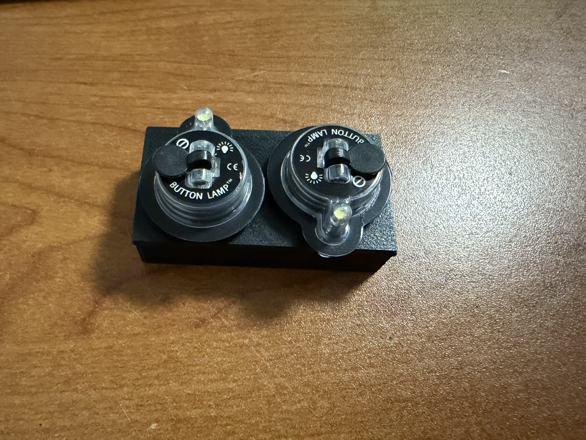
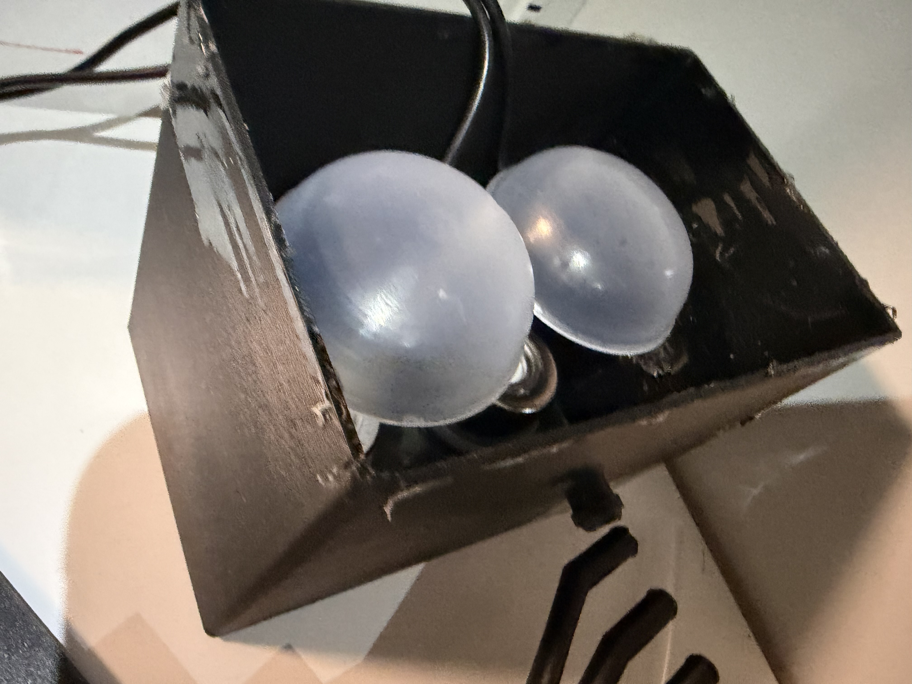
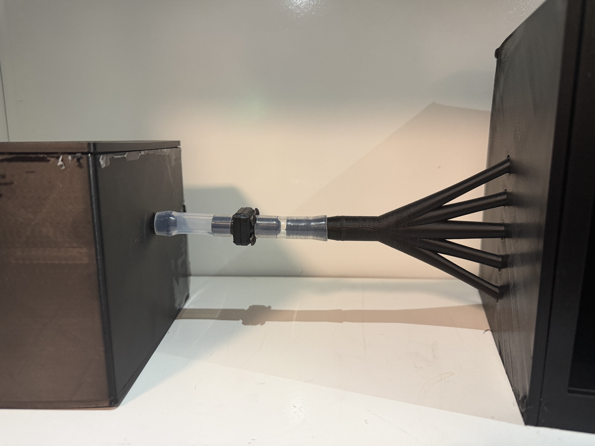
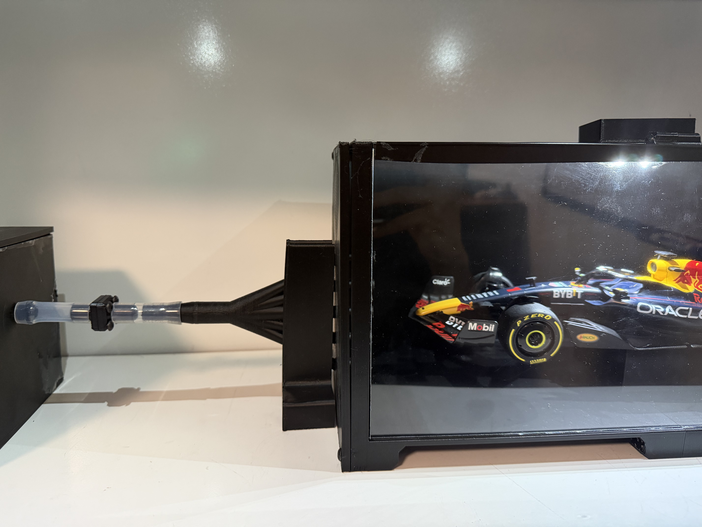

<h1>Instructions for the build! (sadly I do not have pictures of everything)</h1>
<ol> Steps for building!
    <li>Print all the parts and remove supports and poke screw holes if necessary</li>
    <li>Take the 2 honeycomb part things and screw em together with the 10mm screws like this (its okay if they arent flush, just make sure the seal is good) </li>
    <li>Cut 2 roughly 50mm lengths of tubing and attach them on either end of the honeycomb thing like this and also attach the flow shape to the end with the cross sticking out. </li>
    <li>Put the 2 tunnels together by aligning the funny round ish things, place a nut inside the hexagonal part. Screw in a 30mm screw from the left tunnel.</li>
    <li>Then screw in the flat part into the tunnel left with 20mm screws.</li>
    <li>Now hot glue the fan onto the right tunnel, making sure its aligned properly with the nice side visible from inside the tunnel.</li>
    <li>Cut the plexiglass to 2 lengths: 255mm x 165mm and 130mm x 165mm</li>
    <li>Tape them together with electrical tape ig. </li>
    <li>Take the light holder thing and stick 2 on the bottom like this: </li>
</ol>
<ol>Running it!
    <li>Put water into the humidifier box (if it leaks, put silicone and wait for it to cure), about 40mm of water.</li>
    <li>Place the humidifiers + their funny umbrellas into the box aligned.</li>
    <li>Route the wires out the back and put the lid on!</li>
    <li>Connect the tubing assembly to the front of the box & stick the flow shape into the left tunnel with the holder</li>
    <li>Place car of choosing inside the tunnels with the box if needed</li>
    <li>Place the front acrylic panels on through the tape on top.</li>
    <li>Congratulations! You have built the wind tunnel!</li>
</ol>